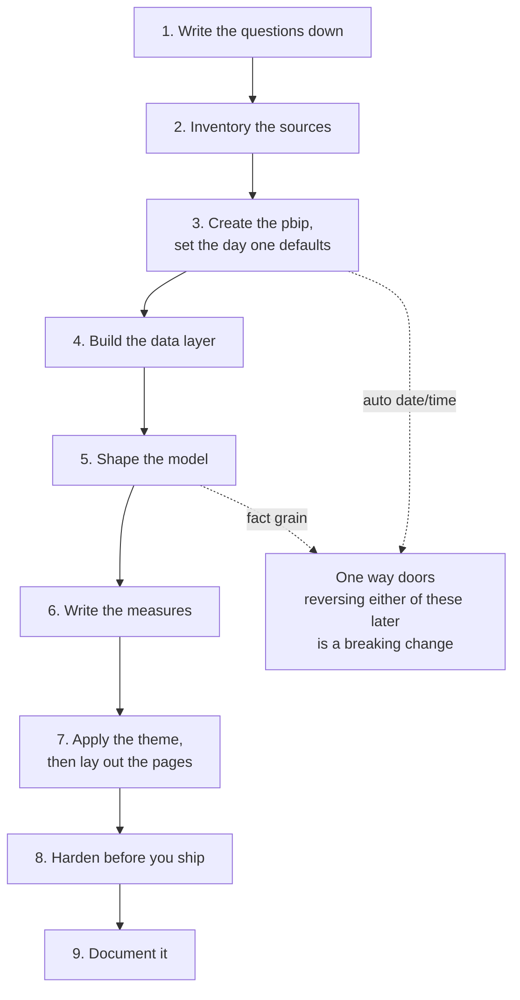

# Power BI build playbook

Checked against Power BI releases through October 2026.

The order to build a Power BI model and report in, and which skill owns each phase. Several
decisions are cheap before the first table loads and expensive afterwards, and two are one way
doors.

## Which skill answers this

| The question | Skill |
| --- | --- |
| How do I get the data in, why is refresh slow | `powerbi-data-and-refresh` |
| What shape should the tables be, how do they relate | `powerbi-modeling` |
| Write or fix a measure | `powerbi-dax` |
| What should the page look like, which chart, what colors | `powerbi-report-design` |
| Write pages and visuals as JSON instead of clicking | `powerbi-pbir-builder` |
| A chart Power BI does not have, a pbiviz, animation between states | `powerbi-custom-visuals` |
| Edit the model files, external tools, what needs Premium | `powerbi-project-and-tools` |
| Document a finished model into a shareable repo | `powerbi-doc-repo` |

## The phase order

1. **Questions.** List the questions the report must answer, in the business's words. That list
   decides the facts, the dimensions, and the pages. One question per page is the target. See
   `powerbi-report-design`.
2. **Sources.** For each source, note what it is, how it connects, and roughly how much data.
   Decide what can be filtered at the source, because on a non folding source that is the only
   filtering that saves time. See `powerbi-data-and-refresh`.
3. **Create the pbip, set the day one defaults.** Every other skill assumes this happened, and it
   needs a person in Desktop. The clicks are in `references/new-model-setup.md`. Turn auto
   date/time off BEFORE the first table loads. Left on, Power BI builds and refreshes a hidden date
   table for every date column.
4. **Data layer.** Staging queries load disabled, filters and column selection at the source,
   paging with a stable order key. Count the fan out as you go. See `powerbi-data-and-refresh`.
5. **Model.** Grain of each fact in one sentence, dimensions split out, one to many relationships
   on clean keys, single cross filter direction, one date or period dimension, everything named and
   hidden properly. Do this before measures, because a measure written against a bad model encodes
   the bad model. See `powerbi-modeling`.
6. **Measures.** Base measures first, then build on them. Every measure into `_Measures` with a
   display folder, a description, and a format string. Check every ratio at the total, not just on
   a row. See `powerbi-dax`.
7. **Theme, then pages.** Theme first, so every visual inherits the look. Use the report's own
   theme if it has one, otherwise the default theme in `powerbi-report-design`. Then layout, chart
   choice, slicers, and navigation. To generate pages or many similar visuals, take the design
   decision to `powerbi-pbir-builder`. Before a build, have a person review a short written spec
   per page (the question, the visuals, the fields, the expected numbers), and start the build
   after that review, not in the same breath.
8. **Harden.** Accessibility pass with the verification greps, refresh timing in the Service and
   not just Desktop, Best Practice Analyzer, and remove what is unused. See
   `powerbi-report-design`, `powerbi-data-and-refresh`, and `powerbi-project-and-tools`.
9. **Document**, once it is real and stable. See `powerbi-doc-repo`.

## The one way doors

Make both deliberately, in phase 3 and phase 5.

1. Auto date/time. Free to turn off on an empty file. Turning it off later breaks every visual
   using a built in date hierarchy and every measure using the `Table[Date].[Year]` syntax.
2. The grain of a fact table. Changing it later means rewriting the measures and usually the
   pages too. Write the grain in one sentence and get agreement on it before building.

## Rules of thumb

- Do not start in the report. A page built before the model is a page you rebuild.
- Get one page working end to end before building ten. The first page finds the modeling
  mistakes.
- Close Power BI Desktop before any file edit, TMDL or PBIR JSON, and reopen to verify. The
  Desktop Bridge is the one other route, see `agent-verification.md` in `powerbi-project-and-tools`.
- Commit early and branch per change.
- Validate numbers against the source before styling anything. A beautiful wrong report is worse
  than an ugly right one.
- When the user asks for something the model cannot answer yet, say so and name the phase it
  belongs to, rather than forcing it at the report layer.
- Reviewing an existing report with its owner: one idea at a time, as a before and after picture
  and one short question. Work in a backup copy, render off screen, and leave the owner's Desktop
  and monitors alone. See `powerbi-project-and-tools`. Taste decisions go in `visual-decisions.md` in
  `powerbi-report-design`.

## References in this skill

- `references/new-model-setup.md`: the manual Power BI Desktop steps to create a pbip and set the
  day one defaults, written as exact clicks, plus the folder layout you should end up with.
