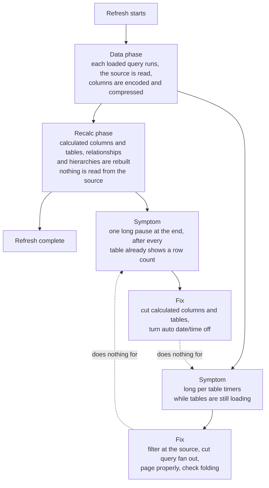

# Power BI data and refresh

This skill covers the data layer: how data gets into the model and why refresh is fast,
slow, or failing. It assumes Power BI Pro (no Fabric or Premium). For the hard license
facts, read `pro-vs-premium-facts.md` in the `powerbi-project-and-tools` skill.

## When to use

Use this for anything about M and Power Query, connecting to a source, paging an API, or a
refresh that is slow or failing. For star schema and relationships use `powerbi-modeling`.
For DAX use `powerbi-dax`. For the pbip and TMDL file format and external tools use
`powerbi-project-and-tools`.

## The mental model

1. Pull only what the model needs. Filter early, select only the columns you use, and push
   work to the source when the source can do it (folding).
2. Watch for the source being read more than once. Referencing another loaded query does
   not reuse its result, it re-runs the whole pipeline.
3. A Pro refresh has a hard 2 hour cap per attempt, and it covers the whole run, not one query.
   Past it, the attempt is cancelled and fails. Most "will not refresh" cases are a timeout, and a
   long load from SharePoint can report that as a credentials error at about one hour. See
   `references/refresh-troubleshooting.md`.
4. Refresh has two phases and they need opposite fixes. The data phase pulls and compresses,
   the recalc phase rebuilds calculated tables, calculated columns, relationships, and
   hierarchies. Know which one is slow before changing anything. See
   `references/refresh-cost-model.md`.

## The two phases, and why the fixes do not swap

Diagnose the phase before changing anything. The two fixes are not interchangeable, and each
one does nothing at all for the other phase.

The two dotted lines crossing are the point. Deleting calculated columns will not rescue a slow
API, and filtering at the source will not rescue a slow recalc. Full detail, including the TMSL
commands that make the split explicit, is in `references/refresh-cost-model.md`.

## On a brand new model, do this first

Set the defaults while the file is still empty, because they are free now and expensive later.

- Turn OFF auto date/time globally (Options, Global, Time intelligence, "Auto date/time for new
  files"). Left on, every date column gets a hidden calculated date table rebuilt on every
  refresh. Build one date table instead and mark it.
- Disable load on staging queries, and keep the number of loaded tables referencing the same
  expensive staging query low.
- Keep the first argument of `Web.Contents` a literal string, with everything variable in
  `RelativePath` and `Query`, or the Service will refuse to refresh a dynamic data source.

Full reasoning and the rest of the list in `references/refresh-cost-model.md`.

## Workflow

1. Identify each source and how it connects. Prefer the most specific connector. For a file
   on SharePoint, read the file directly, do not crawl the whole site (see below).
2. Keep sources thin. Apply filters and column selection as early as possible so less data
   moves and folding has a chance.
3. Check folding. Right click a step and look for "View Native Query". Where it greys out,
   everything after that step runs locally in the mashup engine.
4. For a REST or ServiceNow source, page with a stable cursor and a page size the source can
   assemble inside its own limits. See `references/connecting-to-sources.md`.
5. When refresh is slow or fails, do not guess. Follow the diagnosis steps in
   `references/refresh-troubleshooting.md` and find the one table that eats the time.

## Rules of thumb

- SharePoint file: use `Web.Contents("https://yourtenant.sharepoint.com/sites/Site/.../File.xlsx")`
  wrapped in `Excel.Workbook`. Do NOT use `SharePoint.Files("https://yourtenant.sharepoint.com/sites/Site")`
  for one file, because it enumerates every file in the whole site first and can run for
  many minutes. This alone can cause a multi hour refresh. Only reach for the site crawl when
  the file will move or you cannot get a stable path. Do not use the REST `GetFileById` endpoint
  for a normal read, its credential test is fragile. Full decision rule in
  `references/connecting-to-sources.md`.
- REST paging: page with `List.Generate`, order by a stable key (for ServiceNow,
  `ORDERBYsys_id`), stop as soon as a page returns fewer rows than the page size, and keep the
  row ceiling the same if you change the page size (page size times max pages). `FetchPage`
  must return a declared empty table on a zero row page or `Table.Combine` breaks. Start at a
  page size of 10000 for a ServiceNow Table API and drop to a few thousand if you see "the
  operation was cancelled", which means the source could not assemble the page. Set `Timeout`
  deliberately on every `Web.Contents` call, paged or not. The default is 100 seconds, so a larger
  value raises the limit, and `Timeout` times `MaxPages` has to fit the 2 hour cap. Full loop in
  `references/rest-paging-pattern.md`.
- Do not push a Dataflow Gen1 into a model that also refreshes on a schedule unless you sequence
  the two. Power Automate can start the model refresh when the dataflow succeeds, but that refresh
  counts against the 8, sends no failure email, and shares no transaction with the dataflow. See
  `pro-vs-premium-facts.md` in the `powerbi-project-and-tools` skill.
- Referencing another loaded query (`Source = OtherQuery`) re-runs that query in full every
  time, API calls included. See `references/folding-and-duplication.md`.
- A summary over several published models reads them through composite DirectQuery, which needs
  no refresh ordering at all. See `references/composite-over-published-models.md`.

## References in this skill

- `references/connecting-to-sources.md`: picking the connector, SharePoint and Excel file reads
  including the patterns for a workbook a business user edits, OData, auth, and the literal URL rule.
- `references/rest-paging-pattern.md`: the complete paging loop with the empty page guard, page
  size and timeout rules, flattening reference fields, and building a filter from a table.
- `references/incremental-refresh.md`: RangeStart and RangeEnd in a REST request, one query per
  partition, the partition date and refresh window, and the Pro republish trap.
- `references/m-hardening.md`: surviving schema drift, quoting field names with punctuation,
  text key joins, and turning one row into several.
- `references/parsing-api-values.md`: durations, choice fields, ISO date text, proving a
  `try ... otherwise null` parse ever returned a value, a diagnostic table, and exclusion lists.
- `references/composite-over-published-models.md`: a summary report reading published models over
  DirectQuery, the author consent prompt, tables added later, and a guard for renamed KPIs.
- `references/folding-and-duplication.md`: query folding, and the "referencing a query
  re-runs it" duplication trap, with how to reduce it on Pro.
- `references/refresh-troubleshooting.md`: a step by step for a slow or failing refresh, the
  Pro limits, and what each error message means.
- `references/refresh-cost-model.md`: the design time view. The two refresh phases and how to
  tell which one is slow, what loads each, auto date/time in depth, and the defaults to set on
  a new model before any real work.
