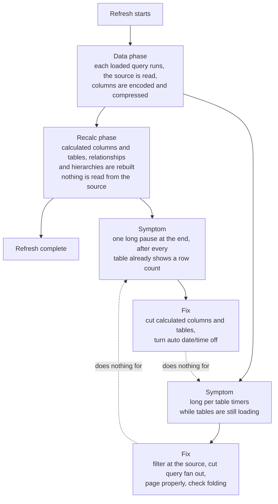

# Power BI data and refresh

How data gets into the model, and why refresh is fast, slow, or failing, on Power BI Pro. License
facts live in `pro-vs-premium-facts.md` in the `powerbi-project-and-tools` skill.

Checked against Power BI releases through October 2026.

Star schema and relationships are `powerbi-modeling`. DAX is `powerbi-dax`. The pbip and TMDL
files and external tools are `powerbi-project-and-tools`.

## The mental model

1. Pull only what the model needs. Filter early, select only the columns you use, and push work
   to the source when it can do it (folding).
2. Referencing another loaded query does not reuse its result. It re-runs the whole pipeline,
   API calls included. See `references/folding-and-duplication.md`.
3. A Pro refresh has a hard 2 hour cap per attempt, covering the whole run, not one query. Past
   it, the attempt is cancelled. Most "will not refresh" cases are a timeout, and a long load from
   SharePoint can report that as a credentials error at about one hour. See
   `references/refresh-troubleshooting.md`.
4. Refresh has two phases with opposite fixes. Know which one is slow before changing anything.

## The two phases, and why the fixes do not swap

Deleting calculated columns will not rescue a slow API, and filtering at the source will not
rescue a slow recalc. The TMSL commands behind the split are in `references/refresh-cost-model.md`.

## On a brand new model, do this first

These are free on an empty file and expensive later. The full list is in
`references/refresh-cost-model.md`.

- Turn OFF auto date/time globally (Options, Global, Time intelligence, "Auto date/time for new
  files"). Left on, every date column gets a hidden calculated date table rebuilt on every
  refresh. Build one date table and mark it.
- Disable load on staging queries, and keep few loaded tables referencing the same expensive one.
- Keep the first argument of `Web.Contents` a literal string, with everything variable in
  `RelativePath` and `Query`, or the Service refuses to refresh a dynamic data source.

## Workflow

1. Identify each source and pick the most specific connector. For one file on SharePoint, read
   the file directly, never crawl the site.
2. Filter and select columns as early as possible.
3. Check folding: right click a step, "View Native Query". Greyed out means everything after it
   runs locally. The new Power Query editor (preview) also shows step folding indicators.
4. For a REST or ServiceNow source, page with a stable cursor and a page size the source can
   assemble inside its own limits.
5. When refresh is slow or fails, do not guess. Follow `references/refresh-troubleshooting.md`
   and find the one table that eats the time. Refresh that one table alone (right click it in
   Desktop, or in web modeling since August 2026).

## Rules of thumb

- SharePoint file: `Excel.Workbook(Web.Contents("https://yourtenant.sharepoint.com/sites/Site/.../File.xlsx"))`.
  Not `SharePoint.Files("https://yourtenant.sharepoint.com/sites/Site")` for one file, which
  enumerates every file in the site first and alone can cause a multi hour refresh. Not the REST
  `GetFileById` endpoint, whose credential test is fragile. See `references/connecting-to-sources.md`.
- REST paging: `List.Generate`, ordered by a stable key (ServiceNow `ORDERBYsys_id`), stop on a
  short page, keep the row ceiling (page size times max pages) when you change the page size.
  `FetchPage` must return a declared empty table on a zero row page or `Table.Combine` breaks.
  ServiceNow Table API: start at 10000 and drop to a few thousand on "the operation was
  cancelled". Set `Timeout` on every `Web.Contents` call (default 100 seconds), and `Timeout`
  times `MaxPages` has to fit the 2 hour cap. See `references/rest-paging-pattern.md`.
- Do not push a Dataflow Gen1 into a model that also refreshes on a schedule unless you sequence
  the two. Power Automate can start the model refresh when the dataflow succeeds, but that refresh
  counts against the 8, sends no failure email, and shares no transaction with the dataflow. See
  `pro-vs-premium-facts.md` in the `powerbi-project-and-tools` skill.
- A summary over several published models reads them through composite DirectQuery and needs no
  refresh ordering. See `references/composite-over-published-models.md`.

## References in this skill

- `references/connecting-to-sources.md`: picking the connector, SharePoint and Excel file reads
  including a workbook a business user edits, OData, auth, the literal URL rule, parameters.
- `references/rest-paging-pattern.md`: the complete paging loop with the empty page and ceiling
  guards, page size and timeout rules, flattening reference fields, a filter built from a table.
- `references/incremental-refresh.md`: RangeStart and RangeEnd in a REST request, one query per
  partition, the partition date and refresh window, and the Pro republish trap.
- `references/m-hardening.md`: surviving schema drift, quoting field names with punctuation,
  text key joins, and turning one row into several.
- `references/parsing-api-values.md`: durations, choice fields, ISO date text, proving a
  `try ... otherwise null` parse ever returned a value, a diagnostic table, exclusion lists.
- `references/composite-over-published-models.md`: a summary report reading published models over
  DirectQuery, the author consent prompt, tables added later, a guard for renamed KPIs.
- `references/folding-and-duplication.md`: query folding, the "referencing a query re-runs it"
  trap, counting fan out, and how to reduce it on Pro.
- `references/refresh-troubleshooting.md`: failure notifications, a step by step for a slow or
  failing refresh, what each error means, the Pro limits, how a schedule stops on its own.
- `references/refresh-cost-model.md`: the design time view. The two phases and how to tell them
  apart, what loads each, auto date/time in depth, day one defaults, a worked case.
