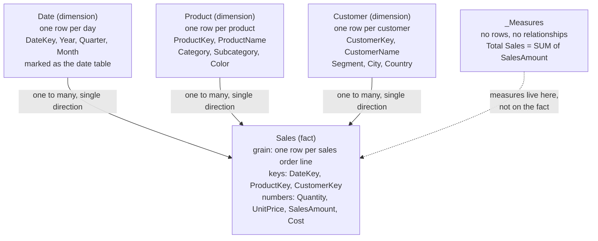

# Power BI modeling

The model layer: table shape, relationships, and where measures and names live, on Power BI Pro.
License facts live in `pro-vs-premium-facts.md` in the `powerbi-project-and-tools` skill.

Checked against Power BI releases through October 2026.

M, Power Query, and refresh are `powerbi-data-and-refresh`. DAX logic is `powerbi-dax`. Page
layout and visuals are `powerbi-report-design`. The pbip and TMDL files and external tools are
`powerbi-project-and-tools`.

## The shape you are aiming at

Arrows point the way filters flow, from dimension ("one" side) into fact ("many" side).

Every arrow runs one way, so no visual can produce an ambiguous filter path. Category and
Subcategory sit inside `Product`, a star not a snowflake. `_Measures` connects to nothing.

## Workflow

1. List the questions the report must answer. They name the facts to measure and the dimensions
   to slice by.
2. Write each fact table's grain in one sentence before adding a column. Different grains go in
   separate fact tables. See `references/star-schema.md`.
3. Split the wide source: facts keep keys and numbers, dimensions carry the descriptive columns.
4. Build one to many relationships from each dimension into the fact, on clean single column keys,
   single direction. See `references/relationships.md`.
5. Add one Date table, mark it, relate it to each date key on the facts. Turn auto date/time off.
6. Put every measure in `_Measures`, hide keys and technical columns, give the rest business names.
   See `references/naming-and-measures.md`.

## Rules of thumb

- Prefer a star over a snowflake and over one big flat table. Flatten a snowflaked dimension
  unless the volume makes that expensive.
- Several facts sharing conformed dimensions is normal. Facts do not relate to each other directly.
- One to many is the default. Before reaching for many to many, work out which case you have: two
  dimensions get a bridge, two facts get shared dimensions, a fact at a higher grain gets a single
  direction many to many with a grain guard in its measures. See `references/many-to-many.md`.
- Single cross filter direction is the default. Turn on both only for a deliberate bridge, and
  never to make one visual work.
- One active relationship per table pair. Extra date roles go through inactive relationships plus
  `USERELATIONSHIP`, or a duplicated dimension. `USERELATIONSHIP` errors when RLS is defined on the
  table involved. See `references/relationships.md`.
- "One" side keys must be unique, non blank, one data type on both ends. A duplicate arriving on
  the "one" side fails the whole refresh. Do not hide it with `Table.Distinct`.
- Never name a table exactly `Measures`. The name is reserved and the model can fail to open. Use
  `_Measures`.
- `changedProperty = IsHidden` in TMDL does not hide anything. Only an `isHidden` line does.
- Every `lineageTag` must be unique model wide. A pasted duplicate stops the project opening, with
  an error naming a different table.
- Keep the model view readable, facts in one column and dimensions in one row. The
  `powerbi-project-and-tools` skill owns the layout and a script that applies it.
- Compute columns upstream in M or at the source when you can. DAX calculated columns compress
  worse and rebuild every refresh.

## References in this skill

- `references/star-schema.md`: tables that are neither fact nor dimension, several facts, the
  grain, snowflake and flat table trade offs, the three fact types, the worked Sales example.
- `references/relationships.md`: cardinality and direction defaults, active vs inactive and
  USERELATIONSHIP, when the one to many rule bends, clean keys, text and composite keys.
- `references/many-to-many.md`: the three many to many cases, bridge tables, a fact at a higher
  grain, and limited relationships.
- `references/naming-and-measures.md`: the `_Measures` table and the reserved name trap, table
  prefixes, measure properties and descriptions, a measure name taxonomy, hiding, the Date table.

## Shared facts

- `pro-vs-premium-facts.md` in the `powerbi-project-and-tools` skill: Pro limits, and the cost of
  calculated columns and tables.
